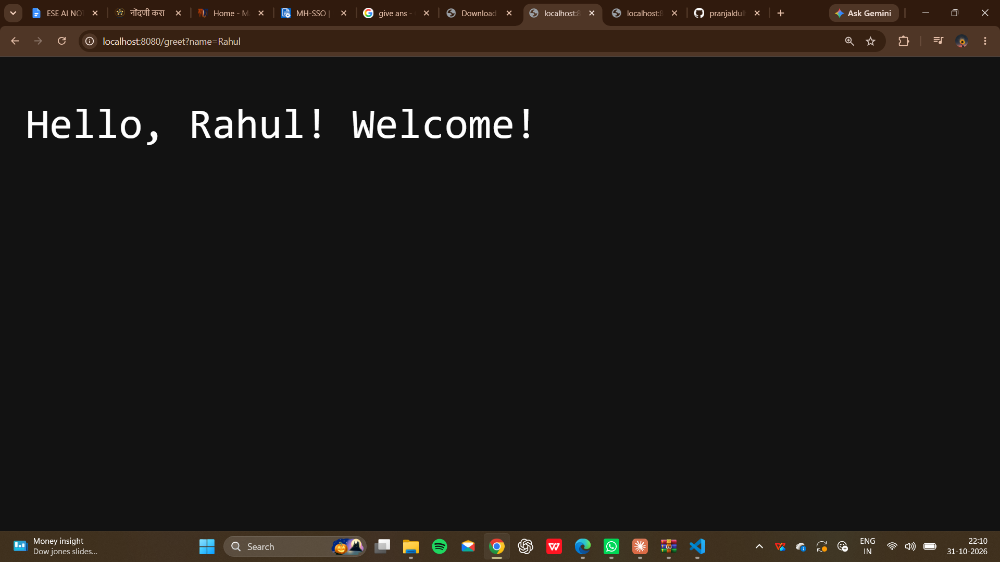
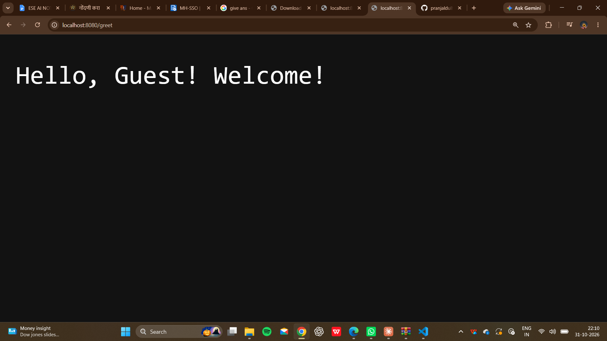

# Greeting Servlet (Maven + Embedded Jetty)

A simple Java servlet project that returns a custom greeting based on a query parameter. The servlet runs on an embedded Jetty server, so no separate application server is needed.

## Features
- Reads the `name` query parameter and returns a personalized greeting
- Falls back to `Guest` if no name is given
- Servlet mapping done in code (no `web.xml` needed)
- Runs with a single Maven command

## Tech Stack
- Java 17
- Maven
- Jakarta Servlet API 5.0
- Embedded Jetty 11

## Project Structure
```
greeting-servlet/
├── pom.xml
└── src/main/java/com/example/
    ├── App.java               # Starts embedded Jetty and maps the servlet
    └── GreetingServlet.java   # Handles GET requests and writes the greeting
```

## Prerequisites
- JDK 17 or higher
- Maven 3.8+

Check with:
```
java -version
mvn -version
```

## How to Run
```
mvn compile exec:java
```
The server starts on port **8080**. Stop it with `Ctrl + C`.

## Usage
| URL | Output |
|-----|--------|
| `http://localhost:8080/greet?name=Rahul` | `Hello, Rahul! Welcome!` |
| `http://localhost:8080/greet` | `Hello, Guest! Welcome!` |

## How It Works
1. `App.java` creates a Jetty `Server` on port 8080.
2. `GreetingServlet` is mapped to the `/greet` path.
3. On a GET request, the servlet reads the `name` parameter and writes the greeting to the response.

## Screenshots
Add your browser screenshots here (create a `screenshots/` folder in the project):




## Author
Your Name